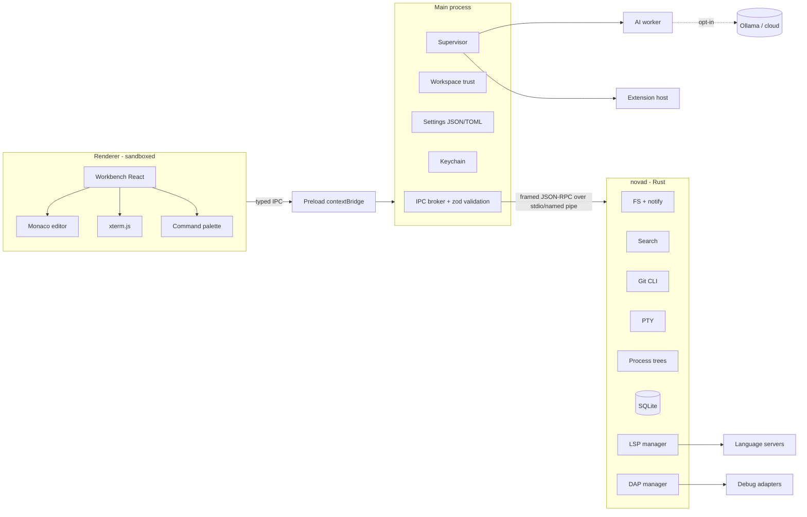
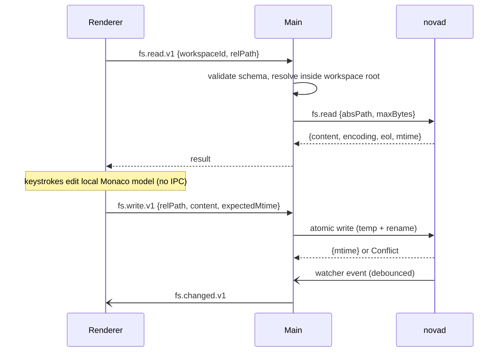

# DHeaven Code: NOVA — Architecture

> Status: design document. Nothing described here is implemented yet. Performance numbers are **targets**, not measurements.

## 1. Overview
NOVA is a desktop IDE composed of isolated processes. The UI (Electron renderer, React + Monaco) never touches the filesystem, shell, or network directly. All privileged work flows through a typed, versioned, validated IPC contract to the Electron main process, which brokers requests to a Rust native daemon (`novad`) and to supervised child processes (language servers, debug adapters, extension host, AI providers).

Guiding invariants:
1. Renderer has no raw fs/shell/network access.
2. A hung LSP, DAP adapter, extension, AI provider or terminal cannot freeze the workbench.
3. Editor input is processed locally in the renderer (Monaco model) — keystrokes never round-trip through IPC.
4. No silent uploads: any network egress of user code is opt-in, visible, and logged.
5. All expensive work is async, cancellable, and bounded (time, memory, result count).
6. No machine-specific paths; everything resolves from OS-standard dirs or workspace-relative paths.
7. Workspace trust gates tasks, extensions, LSP servers and debug launch configs.

## 2. Process model

| Process | Tech | Responsibility | Failure handling |
|---|---|---|---|
| Main | Electron/Node, TS | Window lifecycle, IPC broker, schema validation, trust decisions, settings, keychain, supervisor | Crash = app restart; kept thin |
| Renderer | React, Monaco, xterm.js | Workbench UI, editor models, rendering | No privileges; sandboxed; reload restores session |
| Preload | TS | Exposes a frozen `nova` API via `contextBridge` | Minimal surface |
| `novad` | Rust, Tokio | File I/O, watching (`notify`), search (`ignore` + `grep-searcher`), Git CLI, PTY (`portable-pty`), process trees, SQLite | Supervised; auto-restart with backoff; requests time out |
| LSP servers | external | Language intelligence | Spawned by novad; per-request timeouts; restart on crash |
| DAP adapters | external | Debugging | Spawned by novad; isolated per session |
| Extension host | Node (utilityProcess), sandboxed | Third-party extensions | Capability-gated API; killable; watchdog |
| AI provider worker | Node utilityProcess | Ollama/cloud calls | Off by default; streaming, cancellable |

## 3. Component diagram


## 4. Data flow: open file, edit, save


## 5. IPC contract design
- **Single source of truth:** `packages/ipc-contract` defines every channel with a zod schema for request, response and event payloads; TS types are inferred. Rust types are generated (or hand-mirrored and checked by contract tests) from JSON Schema exported from zod.
- **Naming & versioning:** `<domain>.<action>.v<N>` (e.g. `git.status.v1`). Breaking changes add a new version; old versions kept for one minor release.
- **Envelope:** `{id, channel, payload, cancelToken?, deadlineMs?}` → `{id, ok:true, result} | {id, ok:false, error:{code, message, retryable}}`.
- **Validation:** main validates every renderer message; unknown channels rejected. novad validates again (defense in depth).
- **Cancellation:** every long call returns a handle; `$cancel` propagates to novad/Tokio task. Default deadlines per channel.
- **Backpressure:** streams (search results, terminal output, logs) are chunked and flow-controlled with credit-based acks; results are capped.
- **Transport:** renderer↔main via `ipcRenderer.invoke`/`MessagePort`; main↔novad via length-prefixed JSON-RPC over stdio (binary frames for PTY data may be added later).

## 6. Security model
- Electron: `contextIsolation: true`, `sandbox: true`, `nodeIntegration: false`, `webSecurity: true`, no `remote`, navigation and `window.open` blocked, `will-navigate` denied, permission requests denied by default.
- Strict CSP: `default-src 'self'; script-src 'self'; style-src 'self' 'unsafe-inline'` (Monaco requires inline styles; revisit), `connect-src 'self'`, `worker-src 'self' blob:`, no remote content.
- Path safety: all renderer paths are workspace-relative and canonicalized in main; symlink escapes refused unless trusted.
- **Workspace trust (ADR-0008):** untrusted workspaces open in restricted mode — read/edit allowed; tasks, debug configs, workspace-defined LSP commands, extensions and Git hooks-triggering ops disabled.
- **Secrets:** OS keychain via `keytar`-equivalent / Electron `safeStorage`; never written to config files or logs.
- **Extensions (ADR-0009):** separate process, declared capabilities, user-granted permissions, no direct Node `fs`/`child_process`.
- **AI (ADR-0010):** off by default; context preview before sending; diffs require approval; tool calls from model output are never auto-executed; untrusted file content is delimited and treated as data (prompt-injection defense).
- **Supply chain:** pinned lockfiles, `pnpm audit`/`cargo audit` in CI, SBOM at release.

## 7. Performance budgets (targets, not measurements)
| Metric | Target |
|---|---|
| Cold start to interactive workbench | < 2.0 s on mid-range laptop |
| Keystroke-to-paint in editor | < 16 ms p95 (local, no IPC) |
| Open 1 MB file | < 300 ms |
| Command palette open | < 50 ms |
| Search first results (100k-file repo) | < 500 ms |
| Idle RAM (shell + 1 workspace, no LSP) | < 400 MB |
| Main-process event-loop block | never > 50 ms |
Budgets will be measured by scripted benchmarks from Phase 1 onward and recorded with hardware details in `docs/perf/`.

## 8. Planned repository layout
```
DHeaven-Code-NOVA/
  apps/desktop/            Electron main, preload, renderer (React+Vite)
  packages/ipc-contract/   zod schemas, generated types/JSON Schema
  packages/ui/             NOVA design system, themes (Focus/NOVA/Spectra)
  packages/extension-api/  public extension SDK types
  packages/ai/             provider abstraction (later)
  crates/novad/            Rust daemon binary
  crates/nova-fs, nova-search, nova-git, nova-pty, nova-lsp, nova-dap, nova-store
  extensions/samples/      sample extensions
  fixtures/                test repos
  e2e/                     Playwright tests
  scripts/                 cross-platform build scripts (+ .ps1 for Windows)
  docs/                    architecture, adr, release, perf, security
```

## 9. Visual system
Modes: **Focus** (minimal, no effects), **NOVA** (default; subtle glass & glow), **Spectra** (animated topography, opt-in). Palette: cosmic graphite `#14161C`, midnight navy `#0E1530`, deep ultraviolet `#2A1B5C`, accents cyan `#3FE0FF` and plasma violet `#9B6BFF`. Effects respect `prefers-reduced-motion`, are GPU-cheap, and auto-disable under frame-budget pressure. WCAG AA contrast is a requirement.
